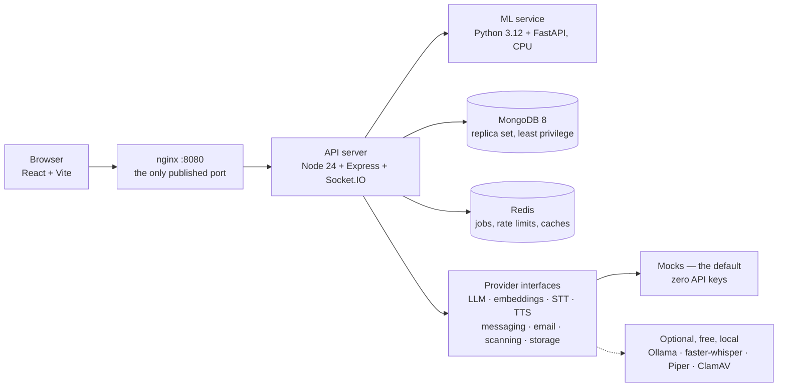

# C.S.A.S — Customer Service Automation System

A bilingual support assistant that answers from an approved knowledge base — in
Lebanese Arabic, Arabizi, Arabic–English code-switching, Modern Standard Arabic
or English — and hands over to a human the moment it is not confident enough.

> **Status: in development.** Phase 1 (foundation and observability) and
> Phase 2 (threat model, data layer, staff and customer authentication) are
> complete. Phase 3 has begun with three design directions, which are built and
> awaiting a choice — open
> [`docs/design/previews/index.html`](docs/design/previews/index.html) to see
> them. The assistant and the dashboard follow. Each step's reasoning, commands
> and verification live in [`docs/steps/`](docs/steps/); badges, screenshots and
> a demo recording are added at the release step, when there is a running
> product to show.

---

## Why this exists

A company that sells and supports IT products answers the same questions
repeatedly, in five different written forms, under a contractual response time.
Three facts shape everything here:

1. **Most questions have been answered before** — in a ticket, a technote, an
   engineer's head.
2. **Lebanese customers write in five forms**, often inside one sentence. Tools
   built for English, or for Modern Standard Arabic alone, do not read the other
   four.
3. **A confident wrong answer costs more than a handover.** Support advice that
   sounds right and is not produces a second, angrier ticket.

So the assistant retrieves first and answers only from what it retrieved, citing
the knowledge-base entry; below a confidence threshold it escalates to the
on-duty agent instead of guessing. Every quality claim in this repository is a
measurement, reported **per input form**, because an average hides Arabizi
performing worse than English.

Full problem statement, the four reference diagrams recreated in Mermaid, and
the places where this build goes beyond them:
**[`docs/00-overview/`](docs/00-overview/README.md)**.

## Architecture



**Every external provider sits behind an interface with a mock implementation.**
The whole application, the demo and every test run with **no API keys, no cloud
account and no GPU**. Where a free local alternative exists it is offered as the
optional "real" provider; no paid service is wired anywhere.

## Stack

| Layer | Choice |
| :-- | :-- |
| Monorepo | npm workspaces (`apps/client`, `apps/server`, `apps/ml`, `packages/shared`) + `uv` for Python |
| Client | React, Vite, React Router, TanStack Query, react-i18next, Tailwind, Radix UI |
| Server | Node 24, Express 5, Mongoose, Socket.IO, pino, zod, BullMQ |
| ML | Python 3.12, FastAPI, scikit-learn, sentence-transformers, pytest |
| Data | MongoDB 8 (single-node replica set, schema validation), Redis |
| Tests | Vitest, Supertest, React Testing Library, Playwright + axe, pytest, k6 |
| Quality | TypeScript strict, ESLint, Prettier, Ruff, mypy strict, Husky, Conventional Commits |

Every choice, with the alternatives that were rejected and why, is in
[`docs/steps/01-planning/`](docs/steps/01-planning/README.md) §4.

## Quick start

Requirements: **Docker Desktop** (or Docker Engine) and **Node 24+**. Nothing
else — no accounts, no keys.

```bash
git clone <this repository>
cd C.S.A.S
npm ci
npm run up          # generates .env, starts the stack, and seeds the database
```

Then open **http://localhost:8080**.

One command, measured from `docker compose down -v`: **88 seconds** to six
healthy services and a seeded database (618 knowledge-base entries, three demo
customers, one admin).

```bash
npm run logs        # follow the logs
npm run seed        # re-prepare the database (idempotent; it never deletes)
npm run down        # stop
```

Already running MongoDB on your machine? Set `MONGO_HOST_PORT=27018` in `.env` —
only the host-side port moves.

### Day-to-day

```bash
npm run verify         # format, lint, type-check, build, secret scan, tests
npm run test:coverage  # enforces the >=80% server coverage gate
npm run test:ml        # pytest
npm run lint:ml        # ruff + ruff format --check + mypy
npm run dev            # server and client natively, with reload
```

## Demo accounts

The demo **data** is seeded by `npm run up`: three customers whose contracts are
active, expiring in nine days and already expired, so every branch of the
contract gate has something behind it. There is nothing to log in *with* yet —
staff authentication is step 06 and customer one-time codes are step 08. This
section will list the accounts, with the `DEMO_MODE` two-factor code shown in
the dashboard's dev inbox.

## Evaluation results

Reported per input form, with 95% confidence intervals, once the evaluation
harness lands in step 21. The headline number will be the **false-answer rate on
questions that should have escalated** — not average answer quality — because
that is the failure that costs a support team trust.

## Security

Targets OWASP ASVS Level 2, the OWASP Top 10, the API Security Top 10 and the
Top 10 for LLM Applications. The threat model (STRIDE over every component and
data flow) and a checklist mapping each requirement to the code and the test
that proves it are written in step 04, before the feature code they protect:
[`docs/security/`](docs/security/).

To report a vulnerability, see `SECURITY.md` (added at the release step).

## Known limitations and future work

Kept current rather than saved for the end.

- **Not deployed, and not production-ready.** This is a portfolio release that
  runs locally. TLS, real messaging and email providers, cloud AI, MongoDB
  Atlas, external monitoring and off-site backups are deliberately out of scope
  and tracked in [`docs/roadmap/PRODUCTION.md`](docs/roadmap/PRODUCTION.md).
- **WhatsApp, SMS and email are mock-only.** Every message the system would have
  sent — OTP codes, escalation alerts, reminders — appears in a dev inbox page
  in the dashboard.
- **The reference diagrams predate the written specification** (December 2024 /
  April 2025). `docs/00-overview` reproduces them as drawn and lists every place
  the build goes further.
- **The human test set will hold ~200 questions**, which gives wide per-input-form
  confidence intervals. Per-form differences will be reported as indicative, not
  significant; the evaluation document says so plainly.
- **Lebanese query variants are generated by an 8B open-weight model**, not the
  70B the research benchmarked, because the 70B is neither free nor laptop-sized.
  A native-speaker review gate is what makes the dataset trustworthy.
- **The LoRA style experiment (step 26) is skipped** in this release.
- **Load testing targets 50 concurrent customers locally**, not 200 on
  representative hardware, and will be labelled as a local result.
- **The privacy page is a demonstration notice, not a privacy policy.** It
  follows the structure of the legal research and carries a visible banner that
  it needs legal review before any real use.
- **Error tracking is an interface, disabled.** Nothing is sent anywhere; the
  scrubbing that any future integration must do is already written and tested.

## AI-assisted development

This project was built with substantial assistance from **Claude** (Anthropic)
acting as a pair programmer: generating code, tests and documentation under a
written specification, with every decision reviewed and every step verified by
running it. Each `docs/steps/NN-*/README.md` records what was built, which
alternatives were rejected and why, and the exact commands and outputs that
prove it works — including the defects found by running the system that no
amount of review had caught.

The design decisions, the scope, the evaluation methodology and the acceptance
of each step are the author's.

## Licence

Code: **Apache-2.0** (see `LICENSE` and `NOTICE`). Project-owned data: **CC BY
4.0**. Third-party datasets keep their own licences, recorded per record and
reported in full at the release step. TechQA, the seed corpus, is
**CDLA-Permissive-1.0** — a correction to the research, which recorded the
repository's code licence instead.
