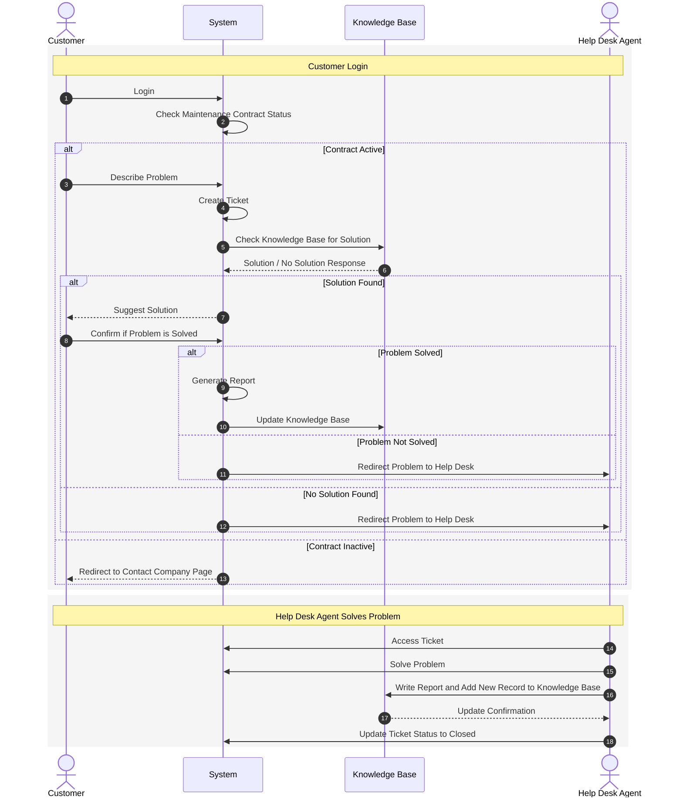
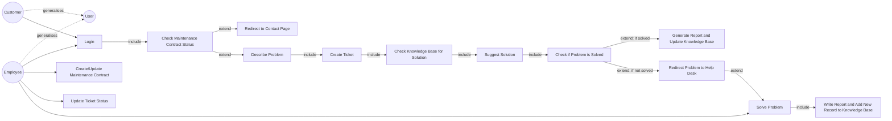
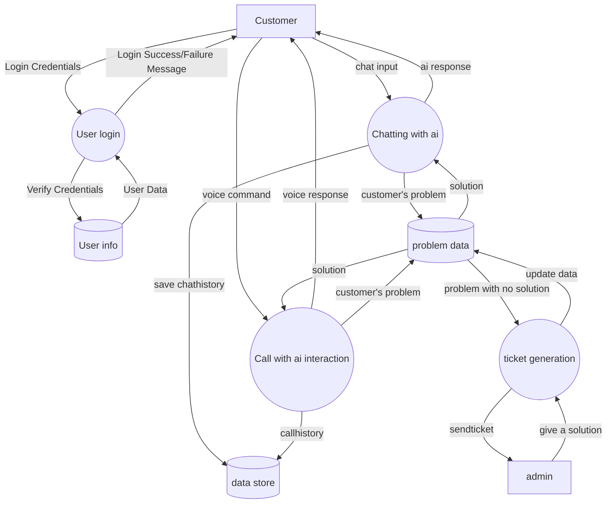
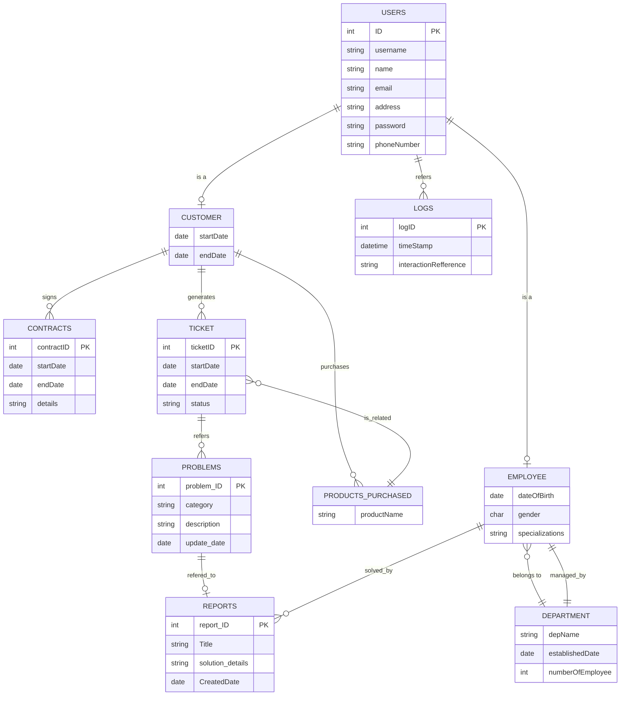
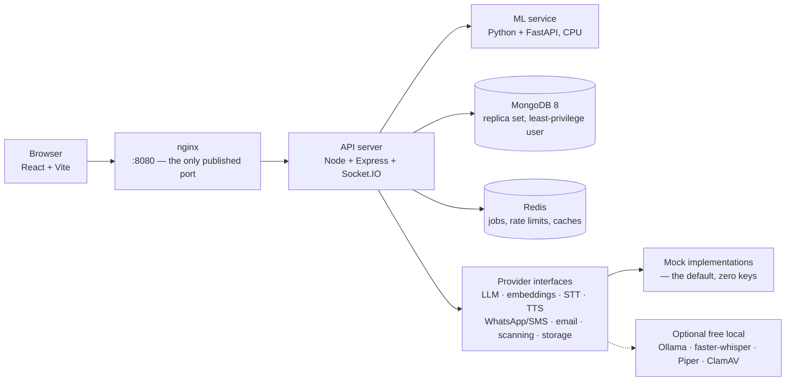

# C.S.A.S — problem, solution, roles and flow

This is the orientation document. It states what the system is for, who uses it,
and how a request moves through it — and it reproduces the four design artefacts
from `reference/` so that every later document can point at a shared picture.

**Provenance.** Every diagram below is a faithful Mermaid recreation of a file
in `reference/`, which is git-ignored (the folder also holds a CSV of real
customer interactions that must never be published — see
[step 01 §1.3](../steps/01-planning/README.md)). Nothing here was invented:
where the written specification goes further than a diagram, that is listed
separately in [§6](#6-where-the-specification-extends-the-diagrams) rather than
quietly drawn in. The diagrams date from December 2024 and April 2025; the
specification is newer than both.

---

## 1. The problem

A company that sells and supports IT products carries a support load with three
properties that make it expensive:

1. **Most of it repeats.** A large share of incoming questions have been
   answered before, by someone, somewhere — in a ticket, a technote, an
   engineer's head.
2. **It arrives in five written forms.** In Lebanon a customer writes in
   Lebanese dialect in Arabic script, in Arabizi (`3am ye2ta3`), in
   Arabic–English code-switching, in Modern Standard Arabic, or in English —
   often several of these inside one sentence. Tools built for English, or for
   MSA alone, do not read the other four.
3. **The cost of a confident wrong answer is higher than the cost of a
   handover.** Support advice that sounds right and is not produces a second,
   angrier ticket and erodes the trust the first one was meant to build.

Add a contractual dimension: support is owed to customers with an active
maintenance contract, within a response time the contract promises.

## 2. The solution

An assistant that answers **only** from an approved knowledge base, in any of
the five written forms, and hands over to a human the moment it is not confident
enough — with the handover, the clock and the evidence all handled by the system
rather than by a person remembering.

Four design commitments follow, and the rest of the project is their
consequence:

| Commitment | What it rules out |
| :-- | :-- |
| Answers are retrieved, then grounded in retrieved text, with the knowledge-base entry cited | A model answering from its own weights, which is where confident invention comes from |
| Below a confidence threshold, escalate instead of answering | "Best effort" answers to questions the knowledge base cannot support |
| Only human-approved content enters the knowledge base and the training data | A feedback loop that teaches the system its own mistakes, and data poisoning |
| Every claim about quality is a measurement, reported per input form | An accuracy headline that hides Arabizi performing far worse than English |

## 3. Roles

| Role | Who | How they get in | What they can do |
| :-- | :-- | :-- | :-- |
| **Customer** | A person at a company with a maintenance contract | One-time code to their registered phone — **no public sign-up**; an admin registers them | Describe a problem by text or voice, attach screenshots, read their own tickets, rate a resolution, reopen a ticket, download a transcript |
| **Agent** (help desk) | Support staff | Password + optional TOTP | Work the ticket queue, take escalations on duty, resolve tickets, add internal notes, propose knowledge-base entries |
| **Admin** | Support manager | Password + **mandatory** TOTP | Everything an agent can, plus customers and contracts, approving knowledge-base entries and data, promoting ML models, the audit log, analytics, and the agent rota |

The reference use-case diagram models this as a single `User` actor
generalised into `Customer` and `Employee`; the specification splits `Employee`
into agent and admin because they need different authority. That split is the
first entry in [§6](#6-where-the-specification-extends-the-diagrams).

## 4. The flow

### 4.1 Sequence — as drawn in `reference/sequence-diagram.png`

### 4.2 Use cases — as drawn in `reference/use-case-diagram.png`

### 4.3 Level-1 data flow — as drawn in `reference/dfd-level1.drawio`

Rectangles are external entities, ellipses are processes, cylinders are data
stores; every flow carries the label from the original.

Those three stores and the boundaries around them are what
[`docs/security/THREAT_MODEL.md`](../security/THREAT_MODEL.md) (step 04) walks
flow by flow. Two observations that the threat model will act on: the voice path
reaches the same stores as the text path and therefore needs the same checks,
and `admin` is an *external entity* here — every instruction entering the system
from that direction is a trust boundary crossing.

### 4.4 Entities — as drawn in `reference/eerd-schema.drawio`

`reference/class-diagram.drawio` carries the same ten entities with their
operations (`login()`, `reportProblem(string)`, `resolveTicket(int)`,
`renewContract()`, …). Those operations map onto API endpoints rather than onto
collections, so they are picked up in [`docs/api`](../api/) instead of here.

## 5. Where a request actually goes

The diagrams describe the logical flow. This is the deployment it runs on
locally — every box is a container started by `npm run up`
([step 02](../steps/02-foundation/README.md)).

Nothing in this release talks to a paid service, and no test needs a key. What
would be a cloud dependency in production is either a mock or a free local
program behind the same interface — the swap is configuration, documented in
[`docs/roadmap/PRODUCTION.md`](../roadmap/PRODUCTION.md).

## 6. Where the specification extends the diagrams

The diagrams are the committee's; the written specification is newer and asks
for more. Everything in this table is a deliberate addition, built because the
specification requires it, and **none of it appears in the reference files**.

| Area | In the diagrams | What the specification adds | Step |
| :-- | :-- | :-- | :-- |
| Roles | `User` → `Customer` / `Employee` | `Employee` split into **agent** and **admin** with different authority; mandatory TOTP for admins | 06 |
| Login | "Login" with credentials | Customer login is a **one-time code to a registered phone**, no password and no public sign-up; staff keep passwords plus 2FA | 06, 08 |
| Contract check | Active / inactive | Dates, tiers, renewal reminders at 30/14/7/1 days, automatic expiry, a customer-initiated renewal request | 31 |
| Knowledge base | "Update Knowledge Base" directly after a resolution | An **approval queue**: an agent proposes, an admin approves, entries are versioned and audit-logged. The diagram's direct write is the single most important thing the specification changes — it is the difference between a knowledge base and an unreviewed log | 17 |
| Answering | "Check Knowledge Base for Solution" | Retrieval by vector similarity, an answer grounded in and citing retrieved entries, a confidence threshold, and a degraded mode that still returns the nearest articles when AI is unavailable | 15, 18 |
| Escalation | "Redirect Problem to Help Desk" | SLA targets per priority and tier, Asia/Beirut business hours and Lebanese holidays, a paused clock while waiting on the customer, an on-duty rota, after-hours queueing, and breach escalation | 14 |
| Input forms | One undifferentiated text flow | Five written forms, normalised, retrieved, answered and **measured separately** | 19–21 |
| Attachments | Not present | Images and PDFs: magic-byte type checks, re-encoding, metadata stripping, malware scanning, private storage, short-lived signed URLs, retention | 12 |
| Voice | "Call with ai interaction" | Consent-gated recording, server-side transcription, a grounded answer, a spoken reply, and a text transcript — with limits on size, duration and type | 28 |
| Data stores | Three stores | ~25 collections including audit logs, sessions, OTP challenges, jobs, notifications, feedback events, dataset items and a model registry | 05 |
| Logs | A `logs` entity | An **append-only audit log** covering logins, recovery, role changes, knowledge-base and model changes, exports and deletions | 06 |
| ML | Not present | An intent classifier, a calibrated escalation classifier, a fine-tuned embedding model, model cards, promotion gates and a human-approved feedback loop | 22–27 |
| Privacy | Not present | Encrypted phone numbers with a hashed lookup index, masked logs, retention periods, consent and opt-out, admin-triggered export and deletion | 05–08 |

## 7. Reading order

| If you want to know | Read |
| :-- | :-- |
| Why each technology was chosen, and what was rejected | [step 01](../steps/01-planning/README.md) §4 |
| How to run it | [step 02](../steps/02-foundation/README.md) §5–6 |
| What was deliberately left out of this release | [`docs/roadmap/PRODUCTION.md`](../roadmap/PRODUCTION.md) |
| What the research says and how current it is | [`docs/research/README.md`](../research/README.md) |
| What a given build step did and how to verify it | `docs/steps/NN-*/README.md` |
