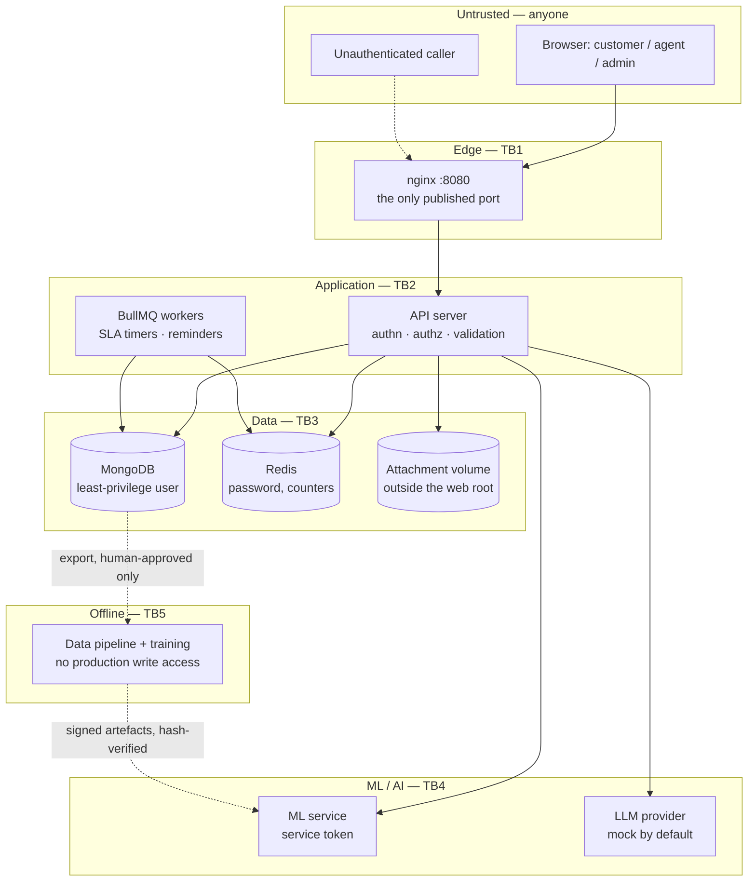

# C.S.A.S threat model

**Method:** STRIDE, applied twice — once per component, once per data flow in the
level-1 DFD (`reference/dfd-level1.drawio`, reproduced in
[`docs/00-overview`](../00-overview/README.md#43-level-1-data-flow--as-drawn-in-referencedfd-level1drawio)) plus the
flows the written specification adds (attachments, voice, escalation, the
knowledge-base approval queue and the training pipeline).

**Targets:** OWASP ASVS Level 2, OWASP Top 10 (2021), OWASP API Security Top 10
(2023), OWASP Top 10 for LLM Applications (2025).

**Written before the feature code it describes.** Every mitigation names the step
that implements it, and
[`CHECKLIST.md`](CHECKLIST.md) tracks each one to the test that proves it. A
mitigation with no test is not a mitigation; it is an intention.

**What this is not.** ASVS L2 is a *target*, not a certification, and no claim of
compliance appears anywhere in this repository. This model covers the portfolio
release, which runs locally with mocked providers; threats that only exist in a
deployed system (TLS stripping, cloud IAM, provider account takeover) are
recorded in [§10](#10-out-of-scope-for-this-release) and in
[`docs/roadmap/PRODUCTION.md`](../roadmap/PRODUCTION.md) rather than silently
omitted.

---

## 1. What an attacker wants

Ranked by what the damage would actually be, because that ranking decides build
order.

| # | Asset | Why it is worth attacking | Worst case |
| :-- | :-- | :-- | :-- |
| A1 | **Customer conversations** (text and voice) | Free-form text written by a person about their business: names, systems, complaints, sometimes credentials pasted in error | Mass disclosure of every customer's support history |
| A2 | **Phone numbers** | The login credential *and* personal data. One number is enough to attempt account takeover | Credential list + contactable victim list |
| A3 | **Staff sessions, especially admin** | An admin can read every ticket, export data, approve knowledge-base entries and promote models | Full system compromise, quietly |
| A4 | **Attachments** | Screenshots of real systems: internal hostnames, licence keys, occasionally identity documents | Disclosure plus a malware-delivery path to staff machines |
| A5 | **The knowledge base** | It is what the assistant is *allowed* to say | Every future customer is told something false — at scale, with the company's voice |
| A6 | **Training data and models** | Poisoned data becomes poisoned behaviour that survives review | Durable, hard-to-detect degradation |
| A7 | **The audit log** | It is the evidence | An intrusion that cannot be reconstructed |
| A8 | **The OTP send path** | Each send costs money in production | SMS-pumping fraud, and denial of login for real customers |

## 2. Threat agents

| Agent | Access they start with | What they are after |
| :-- | :-- | :-- |
| Unauthenticated internet user | The public site and the login endpoints | A1, A2, A8 — enumeration, OTP abuse, injection |
| **Authenticated customer** | A valid session for *their* data | A1, A4 — other customers' tickets and attachments. **The most likely real attacker**, because they are already inside |
| Malicious content author | Can write a ticket or submit knowledge-base text | A5 — prompt injection, stored XSS, data poisoning |
| Curious or careless agent | Dashboard access to assigned tickets | A1 — browsing customers they have no business reading |
| Compromised agent account | Everything that agent can do | A3, A5 — privilege escalation to admin |
| Attacker on the internal network | Can reach container ports | A1, A6 — unauthenticated internal services |
| Supply-chain attacker | A dependency or base image | Everything |

Note the second row. Most of this system's security budget goes to **object-level
authorization** (API Top 10 #1) because the attacker with a valid session and
someone else's ticket id is the realistic one, not the mythical outsider.

## 3. Trust boundaries

| Boundary | Crossing | Rule |
| :-- | :-- | :-- |
| **TB1** edge | Internet → nginx | Only port 8080 is published. MongoDB and the ML service bind to `127.0.0.1` only; `/metrics` is not proxied |
| **TB2** application | nginx → server | Everything beyond here is authenticated, authorized per object, and validated by zod. `trust proxy` is exactly one hop |
| **TB3** data | server → stores | Least-privilege database user; Redis requires a password; attachments live outside any web root and are served only through short-lived signed URLs after an access check |
| **TB4** AI | server → ML/LLM | Service-to-service token; the model gets **no tools and no database access**; retrieved content and user text are data, never instructions |
| **TB5** offline | production → training | One direction, human-gated. Only human-approved, consented, de-identified records leave; only hash-verified artefacts come back |

TB5 is the boundary most systems forget. It is drawn deliberately: the training
pipeline is where an attacker gets to influence the system's *future* behaviour,
and where a privacy mistake becomes permanent.

## 4. STRIDE per component

Each row names the step that implements the mitigation. `✔` marks a mitigation
already in place.

### 4.1 Client (React, in the browser)

| | Threat | Mitigation | Step |
| :-- | :-- | :-- | :-- |
| **S** | Phishing page imitating the login | No credentials beyond a one-time code; the code's message names the company and purpose | 08 |
| **T** | Stored XSS from ticket text or a knowledge-base answer rendering as markup | No `dangerouslySetInnerHTML`; all rendered rich text sanitized; strict CSP without `unsafe-inline` | 10, 32 |
| **R** | — (the client is not an evidence source) | | |
| **I** | Tokens readable by injected script | Refresh token in an `httpOnly` cookie; access token in memory only, never `localStorage` | 06 |
| **D** | — | | |
| **E** | Hiding a control instead of enforcing a permission | Every authorization decision is server-side; the UI only hides what the server would refuse anyway | 06, 29 |

### 4.2 nginx (edge)

| | Threat | Mitigation | Step |
| :-- | :-- | :-- | :-- |
| **S** | Forged `X-Forwarded-For` to evade per-IP limits | `trust proxy` = 1 hop exactly ✔ | 03 |
| **T** | Request smuggling / header injection | Single proxy, no custom header rewriting, body size bound at 12 MB ✔ | 02 |
| **I** | Internal services exposed by accident | Only 8080 published; `/metrics` returns 404 at the proxy ✔ | 02, 03 |
| **D** | Flood of oversized bodies reaching Node | `client_max_body_size` at the edge, before the application ✔ | 02 |

### 4.3 API server

| | Threat | Mitigation | Step |
| :-- | :-- | :-- | :-- |
| **S** | Credential stuffing; OTP brute force; session fixation | Argon2id; TOTP mandatory for admins; lockout with backoff; OTP 6 digits hashed, 5-minute expiry, single use, max 5 attempts; refresh-token rotation with **family revocation on reuse** | 06, 08 |
| **T** | NoSQL operator injection (`{"$ne": null}` as a password); mass assignment; CSRF on cookie-authenticated writes | zod on every body, query, param and socket event, rejecting unknown keys; never build a query or regex from raw input; explicit field allow-lists; CSRF token on cookie-authenticated state changes | 06–08 |
| **R** | Staff denying an action | Append-only audit log for logins, recovery, role changes, knowledge-base and model changes, exports, deletions, contract changes | 06 |
| **I** | **IDOR — reading another customer's ticket, transcript or attachment** | Object-level checks in the repository layer on every read *and* write, with tests that attempt cross-customer access and assert 404/403; socket rooms authorized at join | 11–13 |
| **I** | Personal data leaking into logs or error bodies | Field-name redaction; free-form text never logged; internal errors reduced to a bare 500 plus a request id ✔ | 03 |
| **D** | Request floods; expensive AI calls as an amplifier | Rate limits on every route, strict on auth/OTP/chat/upload/contact; per-customer AI quotas; timeouts, circuit breaker and a degraded mode | 08, 18 |
| **E** | Agent performing admin actions; horizontal escalation between staff | Role checks plus object-level checks; admin-only routes tested from an agent session and asserted to fail | 06, 29 |

### 4.4 MongoDB

| | Threat | Mitigation | Step |
| :-- | :-- | :-- | :-- |
| **S** | Connecting as root from the application | Dedicated `csas_app` user, `readWrite` on one database; verified live — reading `admin.system.users` is denied ✔ | 02 |
| **T** | Unvalidated documents; broken multi-document invariants | JSON-schema validation per collection; transactions for token rotation + session revocation + audit entry (the replica set exists for this) | 05, 06 |
| **I** | Phone numbers readable in a dump | Phone encrypted at rest (AES-256-GCM) with a separate **hashed lookup index** so login can still find a number without decrypting the table | 05, 08 |
| **D** | Unbounded collection growth | Indexes, retention sweeps, TTL on OTP challenges and sessions | 05, 14 |
| **E** | — | Internal auth via keyfile; no port on a routable address ✔ | 02 |

### 4.5 Redis

| | Threat | Mitigation | Step |
| :-- | :-- | :-- | :-- |
| **S/E** | Unauthenticated access resetting rate-limit counters | `requirepass`, no published port; verified — `redis-cli ping` returns `NOAUTH` ✔ | 02 |
| **T** | Race between two OTP requests defeating a limit | Counters incremented **atomically**, never read-modify-write | 08 |
| **I** | Session and queue payloads holding personal data | Store identifiers and hashes, never message bodies or codes | 08, 14 |
| **D** | Queue flooded with jobs | Bounded queues, idempotency keys, dead-letter handling | 14 |

### 4.6 ML service

| | Threat | Mitigation | Step |
| :-- | :-- | :-- | :-- |
| **S** | Anything on the network calling it | Bearer service token compared in constant time; verified — 401 without it ✔ | 02 |
| **T** | **Loading a malicious model artefact** | safetensors/ONNX only, hashes recorded and verified before load. **Never `pickle`** — `pickle.load` is arbitrary code execution, and that is the single sharpest edge in the ML stack | 22, 27 |
| **R** | A prediction that cannot be explained later | Model version recorded on every inference used in a decision | 27 |
| **I** | Embeddings leaking their source text | Treated as personal data: same access rules, same retention | 15, 22 |
| **D** | Expensive inference as a denial-of-service vector | Input length caps, timeouts, CPU-only bounded inference | 18, 22 |
| **E** | — | Runs as `mlsvc`, non-root ✔; no database credentials at all | 02 |

### 4.7 Attachment pipeline

The highest-risk feature in the product, so it gets its own row per threat rather
than a summary line.

| Threat | Mitigation | Step |
| :-- | :-- | :-- |
| Malware uploaded, then downloaded by an agent | ClamAV scan before the file is retrievable; mock scanner detects EICAR so the interface is genuinely exercised | 12 |
| Polyglot / content-type lie (`.png` that is a script) | Type decided by **magic bytes**, never by filename or client-supplied `Content-Type`; allow-list of JPEG, PNG, WebP, PDF | 12 |
| Stored XSS via SVG or HTML masquerading as an image | SVG not accepted; images re-encoded server-side, which destroys any embedded payload; downloads served with `Content-Disposition: attachment` and `X-Content-Type-Options: nosniff` | 12 |
| **GPS coordinates in a customer's photo** | All metadata stripped during re-encode — this is a privacy leak the customer did not know they were sending | 12 |
| Guessing another customer's attachment URL | Unguessable identifiers **plus** an ownership check **plus** short-lived signed URLs. Any one alone is insufficient | 12 |
| Decompression bomb / pixel flood | Dimension and byte limits enforced before decode; count limit per ticket | 12 |
| Files accumulating forever | Retention period with scheduled deletion | 12, 14 |
| Path traversal in a filename | Server-generated names only; the client's filename is metadata, never a path | 12 |

### 4.8 LLM and retrieval (OWASP LLM Top 10)

| ID | Threat | Mitigation | Step |
| :-- | :-- | :-- | :-- |
| LLM01 | **Prompt injection** — a customer writes "ignore previous instructions"; or a *knowledge-base entry* contains instructions (indirect injection, the nastier one) | System prompt is never concatenated with user text; retrieved content is delivered as clearly-delimited untrusted data; the model has no tools and no database; output is constrained to an answer plus cited entry ids; injection cases are explicit tests | 15, 34 |
| LLM02 | Sensitive information disclosure in an answer | Answers are grounded in retrieved entries only; retrieval is scoped to approved public knowledge-base content, never to other customers' tickets | 15, 17 |
| LLM03 | Supply chain (models, datasets) | Licences recorded per dataset; model artefacts hash-verified; no pickle | 22, 27, 37 |
| LLM04 | **Data poisoning** | Only human-approved entries enter the knowledge base; only human-approved, consented records enter training. This is why the approval queue exists at all | 17, 20, 27 |
| LLM05 | Improper output handling | Output rendered as text, never as markup; length bounded; citations validated against the ids actually retrieved | 15 |
| LLM06 | Excessive agency | The model cannot act. It returns text; the application decides | 15 |
| LLM08 | Vector/embedding weaknesses | Retrieval filtered to approved entries before similarity, not after | 15, 17 |
| LLM09 | Overreliance on a confident answer | Confidence threshold with calibrated probabilities; escalate below it; the headline metric is the **false-answer rate on questions that should escalate** | 15, 21, 24 |
| LLM10 | Unbounded consumption | Per-customer quotas, timeouts, circuit breaker, answer and embedding caches | 18 |

### 4.9 Training pipeline (TB5)

| | Threat | Mitigation | Step |
| :-- | :-- | :-- |
| **T** | Poisoned examples reaching a training set | Two-reviewer approval with recorded agreement; lineage id on every record; only approved items exported | 19, 20 |
| **I** | Personal data escaping into a dataset or a model | De-identification pass as a **gate**, not a formality; consent and opt-out respected at export; raw audio, contracts and attachments excluded from training by default | 19, 27 |
| **T** | A model promoted because it looks better on a leaked test set | Lineage-aware splits with near-duplicate and paraphrase leakage audits; the human test set is frozen and never used for training or threshold tuning | 21, 22 |
| **E** | Automatic deployment of a retrained model | Retraining is admin-triggered; promotion requires beating the incumbent on held-out **and** human sets with no per-input-form regression, after shadow evaluation, with admin approval and one-click rollback | 27 |

## 5. STRIDE per data flow

Flow numbers follow the level-1 DFD; F7 onward are flows the specification adds.

| # | Flow | Boundary | Primary threat | Mitigation | Step |
| :-- | :-- | :-- | :-- | :-- | :-- |
| F1 | Customer → *User login* (credentials) | TB1→TB2 | Enumeration: "this number is not registered" tells an attacker who is a customer. OTP brute force. SMS pumping | **Identical responses** whether or not the number exists; hashed single-use code, 5-minute expiry, 5 attempts; layered atomic limits per number/IP/prefix; destination allow-list; send caps with a kill switch; **codes never logged** | 08 |
| F2 | *User login* ↔ *User info* store | TB2→TB3 | Injection via the lookup; dumping the number table | Parameterized lookup by **hashed** phone; encrypted at rest | 05, 08 |
| F3 | Customer → *Chatting with AI* (chat input) | TB1→TB2 | Prompt injection; XSS stored for an agent to view; oversized input | Validation and length caps; text treated as data everywhere; sanitized on render | 11, 15 |
| F4 | *Chatting with AI* ↔ *problem data* | TB2→TB3 | Retrieving another customer's problem; retrieving unapproved content | Retrieval filtered to approved knowledge-base entries; ticket reads scoped by owner | 15, 17 |
| F5 | Customer ↔ *Call with AI* (voice) | TB1→TB2 | Recording without agreement; huge audio as denial of service; a voice file is biometric-adjacent personal data | Explicit consent before capture, with an equally available unrecorded path; size/duration/type limits; same storage controls as attachments; 30-day retention | 28 |
| F6 | *ticket generation* → admin (sendticket) | TB2→TB1 | Escalation message leaking ticket content to a phone that is no longer the agent's; webhook forgery | Notification carries a link and a reference, **not the conversation**; webhook signatures verified over raw bytes; handlers idempotent | 16 |
| F7 | Customer → attachment upload | TB1→TB3 | §4.7 in full | §4.7 | 12 |
| F8 | Agent → knowledge-base candidate | TB2→TB3 | Poisoning the source of truth; indirect prompt injection planted in an entry | Admin approval required before the assistant can use it; versioned and audit-logged; injection-shaped content is a test case | 17, 34 |
| F9 | Admin → data export / deletion | TB2→TB1 | Mass exfiltration through a legitimate feature | Admin-only, audited, rate-limited, and the export records who asked and why | 29 |
| F10 | Production → training export | TB3→TB5 | §4.9 | §4.9 | 19, 27 |
| F11 | Model artefact → ML service | TB5→TB4 | Arbitrary code execution on load | safetensors/ONNX, hash verified before load; no pickle | 22, 27 |
| F12 | Server ↔ ML service | TB2→TB4 | Unauthenticated internal call | Service token, constant-time compare ✔ | 02 |
| F13 | Socket.IO events | TB1→TB2 | Joining another customer's room; unvalidated event payloads | Authenticated handshake; room authorization on join; zod on every event | 11 |

## 6. Risk ranking

Likelihood × impact, which is how the build order was chosen.

| Risk | L | I | Score | Addressed |
| :-- | :-: | :-: | :-: | :-- |
| Cross-customer data access (IDOR) | High | High | **9** | 11–13, tested in 34 |
| Prompt injection producing a false, cited-looking answer | High | High | **9** | 15, 18, tested in 34 |
| OTP abuse (brute force, pumping, enumeration) | High | Med | **6** | 08 |
| Malicious attachment reaching an agent's machine | Med | High | **6** | 12 |
| Personal data in logs, exports or training sets | Med | High | **6** | 03 ✔, 19, 27 |
| Session theft or replay | Med | High | **6** | 06, 07 |
| Knowledge-base poisoning by an insider | Low | High | **3** | 17, audit in 06 |
| Dependency/supply-chain compromise | Low | High | **3** | 02 ✔, CI audits, CodeQL |
| Denial of service against AI endpoints | Med | Med | **4** | 18 |

## 7. Decisions this model forces on later steps

Recorded here so no later step quietly reverses one.

1. **Object-level authorization lives in the repository layer**, not in route
   handlers. A check that can be forgotten in one of forty handlers will be.
2. **Retrieval is filtered before similarity, not after.** Filtering after means
   the index is still searched, which leaks existence through timing and makes a
   future bug a disclosure.
3. **Escalation messages never contain conversation text.** A phone number
   outlives the person who owned it.
4. **The OTP code is never written anywhere but the hash column.** Not a log, not
   an error, not an event, not a metric label.
5. **Identical responses on every account-existence question** — OTP start,
   password reset, login. Including the *timing*, within reason.
6. **No pickle, ever.** Not in a notebook, not "just for the experiment".
7. **The human test set is write-once.** It is never used for tuning, and never
   placed in the knowledge base.

## 8. Residual risks accepted for this release

Stated plainly rather than omitted, because a threat model that claims to have
solved everything is not a threat model.

| Risk | Why accepted | Revisit |
| :-- | :-- | :-- |
| No TLS locally | Nothing leaves the machine; the browser and API are same-origin through the proxy | Roadmap P5 |
| Secrets live in a `.env` file | A local file, git-ignored, generated per machine; no secret manager exists at this scale | Roadmap P6 |
| ClamAV is opt-in | ~2 GB of RAM for a demo; the mock scanner exercises the same interface and detects EICAR | Enable the `scan` profile |
| Audit log is append-only *by convention plus database rules*, not WORM storage | Immutable storage is an infrastructure feature this release does not deploy | Roadmap P7 |
| No external alerting | Alerts surface in the dashboard and dev inbox | Roadmap P7 |
| Rate limits are per-instance | One instance runs; Redis counters already make them shareable | Roadmap P5 |

## 9. Privacy threats

Privacy failures have their own document, because the mitigations are legal and
procedural as well as technical: [`PRIVACY.md`](PRIVACY.md). The three that drive
design here are the encrypted-phone-with-hashed-index scheme (§4.4), the
training-export gate (§4.9), and the retention schedule that makes "we delete
it" true.

## 10. Out of scope for this release

Physical security; the host operating system and Docker daemon; the security of
the reviewer's own machine; denial of service at the network layer; and any
threat that requires a deployed, internet-reachable instance. All are listed in
the roadmap rather than treated as solved.

## 11. Maintenance

This document is updated **in the step that changes the system**, not
retrospectively. Each step's README names the controls it added and links the
checklist rows it moved from "planned" to "done". Step 34 re-walks every row
against the implementation and reports what does not hold.
